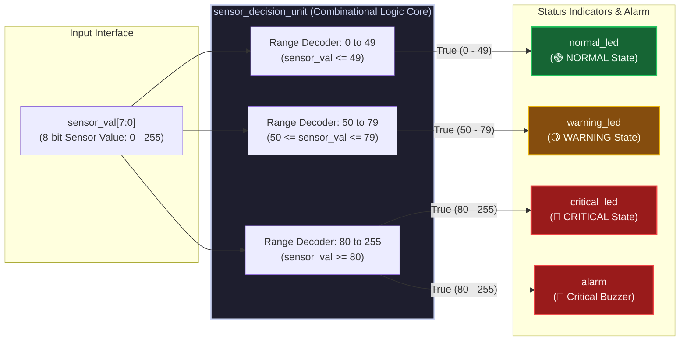
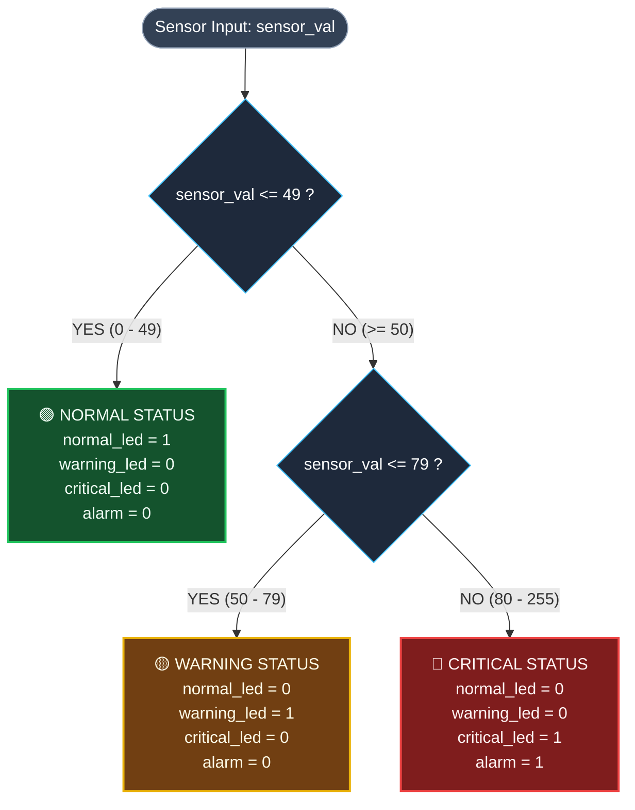

# 🚨 Sensor Status Decision Unit (Verilog HDL)

[-00599C?logo=xilinx)](https://en.wikipedia.org/wiki/Verilog)
[](https://www.xilinx.com/products/design-tools/vivado.html)
[-7B1FA2)](https://www.xilinx.com/products/silicon-devices/fpga/artix-7.html)
[](https://github.com/)
[](LICENSE)

An optimized, combinational logic-based decision unit in **Verilog HDL** that classifies raw 8-bit digital sensor telemetry into three distinct operational states (**NORMAL**, **WARNING**, and **CRITICAL**). The architecture drives dedicated hardware LED status lines and triggers a critical audio/visual alarm. Fully verified and synthesized for **AMD/Xilinx Artix-7 FPGA** (Digilent Basys 3) using **Vivado Design Suite**.

---

## 📌 Table of Contents
- [1. Architecture & Design Specifications](#1-architecture--design-specifications)
- [2. System Block Diagram](#2-system-block-diagram)
- [3. Logic Classification & Truth Table](#3-logic-classification--truth-table)
- [4. Verification & Simulation Results](#4-verification--simulation-results)
- [5. FPGA Synthesis & Resource Utilization](#5-fpga-synthesis--resource-utilization)
- [6. Basys 3 Physical Pin Mapping (XDC)](#6-basys-3-physical-pin-mapping-xdc)
- [7. Directory Structure](#7-directory-structure)
- [8. Quick Start Guide](#8-quick-start-guide)
  - [Option A: One-Click CLI Simulation & Synthesis](#option-a-one-click-cli-simulation--synthesis)
  - [Option B: Open in Vivado GUI](#option-b-open-in-vivado-gui)
  - [Option C: Live Interactive Tester](#option-c-live-interactive-tester)
- [9. Continuous Integration (CI)](#9-continuous-integration-ci)
- [10. License](#10-license)

---

## 1. Architecture & Design Specifications

- **Logic Design Style**: Pure Combinational Logic (Single-cycle latency, zero flip-flops, zero latches).
- **Input Telemetry**: `sensor_val[7:0]` (8-bit unsigned integer, range $0 \dots 255$, $0\text{x}00 \dots 0\text{x}\text{FF}$).
- **Output Indicators**:
  - `normal_led` (Active-high Green indicator)
  - `warning_led` (Active-high Yellow indicator)
  - `critical_led` (Active-high Red indicator)
  - `alarm` (Active-high audio/visual buzzer control line)

---

## 2. System Block Diagram



### Classification Flowchart



---

## 3. Logic Classification & Truth Table

| State Category | Input Range (`sensor_val`) | Hex Range | `normal_led` | `warning_led` | `critical_led` | `alarm` | Active System Behavior |
| :--- | :---: | :---: | :---: | :---: | :---: | :---: | :--- |
| 🟢 **NORMAL** | `0` – `49` | `0x00` – `0x31` | **1 (ON)** | 0 | 0 | 0 | Nominal operational state. |
| 🟡 **WARNING** | `50` – `79` | `0x32` – `0x4F` | 0 | **1 (ON)** | 0 | 0 | Cautionary threshold reached. |
| 🔴 **CRITICAL** | `80` – `255` | `0x50` – `0xFF` | 0 | 0 | **1 (ON)** | **1 (ON)** | Hazardous state: LED and Alarm asserted. |

### Sample Test Vector Matrix

| Test Case | Value (Dec) | Value (Hex) | Binary (`sensor_val[7:0]`) | Normal LED | Warning LED | Critical LED | Alarm | Status |
| :---: | :---: | :---: | :---: | :---: | :---: | :---: | :---: | :---: |
| Lower Bound | `0` | `0x00` | `00000000` | **1** | 0 | 0 | 0 | **NORMAL** |
| Sample 1 | `49` | `0x31` | `00110001` | **1** | 0 | 0 | 0 | **NORMAL** |
| Boundary | `50` | `0x32` | `00110010` | 0 | **1** | 0 | 0 | **WARNING** |
| Sample 2 | `65` | `0x41` | `01000001` | 0 | **1** | 0 | 0 | **WARNING** |
| Sample 3 | `79` | `0x4F` | `01001111` | 0 | **1** | 0 | 0 | **WARNING** |
| Sample 4 | `80` | `0x50` | `01010000` | 0 | 0 | **1** | **1** | **CRITICAL + ALARM** |
| Mid-point | `128` | `0x80` | `10000000` | 0 | 0 | **1** | **1** | **CRITICAL + ALARM** |
| Upper Bound | `255` | `0xFF` | `11111111` | 0 | 0 | **1** | **1** | **CRITICAL + ALARM** |

---

## 4. Verification & Simulation Results

The testbench (`tb/tb_sensor_decision_unit.v`) executes both targeted checks and an automated 256-step exhaustive verification sweep.

```text
===============================================================================
   SENSOR STATUS DECISION UNIT - VERIFICATION SUITE (VIVADO SIMULATION)
===============================================================================
--- PHASE 1: TARGETED SPECIFICATION SAMPLE TEST CASES ---
[PASS] Input:   0 (0x00) | Status: NORMAL (Min)     | LEDs [NORM:1 WARN:0 CRIT:0] | ALARM: 0
[PASS] Input:  49 (0x31) | Status: NORMAL (Sample)  | LEDs [NORM:1 WARN:0 CRIT:0] | ALARM: 0
[PASS] Input:  50 (0x32) | Status: WARNING (Min)    | LEDs [NORM:0 WARN:1 CRIT:0] | ALARM: 0
[PASS] Input:  65 (0x41) | Status: WARNING (Sample) | LEDs [NORM:0 WARN:1 CRIT:0] | ALARM: 0
[PASS] Input:  79 (0x4f) | Status: WARNING (Sample) | LEDs [NORM:0 WARN:1 CRIT:0] | ALARM: 0
[PASS] Input:  80 (0x50) | Status: CRITICAL + ALARM | LEDs [NORM:0 WARN:0 CRIT:1] | ALARM: 1
[PASS] Input: 128 (0x80) | Status: CRITICAL + ALARM | LEDs [NORM:0 WARN:0 CRIT:1] | ALARM: 1
[PASS] Input: 255 (0xff) | Status: CRITICAL + ALARM | LEDs [NORM:0 WARN:0 CRIT:1] | ALARM: 1

--- PHASE 2: EXHAUSTIVE SWEEP VERIFICATION (0 TO 255) ---
Targeted Test Cases Checked : 8
Exhaustive Input Sweep      : 256/256 values tested
Total Failures Detected     : 0
STATUS: >>> TEST SUITE PASSED SUCCESSFULLY! ALL OUTPUTS COMPLIANT <<<
===============================================================================
```

---

## 5. FPGA Synthesis & Resource Utilization

Synthesized using **AMD/Xilinx Vivado 2019.2** for target device **Artix-7 `xc7a35tcpg236-1`**:

| Resource | Used | Available | Utilization % | Comments |
| :--- | :---: | :---: | :---: | :--- |
| **Slice LUTs** | **3** | 20,800 | **0.01%** | Minimal area; optimized boolean logic |
| **Slice Registers (FF)** | **0** | 41,600 | **0.00%** | Pure combinational logic |
| **Latches** | **0** | 41,600 | **0.00%** | 100% latch-free synthesizable RTL |
| **Bonded IOBs** | **11** | 106 | **10.38%** | 8 Inputs + 3 LEDs + 1 Alarm Pin |
| **DSP48 Blocks** | **0** | 90 | **0.00%** | None needed |
| **Block RAM (BRAM)** | **0** | 50 | **0.00%** | None needed |

Synthesis completed with **0 Errors, 0 Warnings, and 0 Critical Warnings**.

---

## 6. Basys 3 Physical Pin Mapping (XDC)

The design is mapped to physical I/O pins for the **Digilent Basys 3 FPGA Board**:

| Port Name | Board Hardware Component | FPGA Pin | I/O Standard | Description |
| :--- | :--- | :---: | :---: | :--- |
| `sensor_val[0]` | Slide Switch `SW0` | `V17` | LVCMOS33 | LSB of sensor input |
| `sensor_val[1]` | Slide Switch `SW1` | `V16` | LVCMOS33 | Sensor bit 1 |
| `sensor_val[2]` | Slide Switch `SW2` | `W16` | LVCMOS33 | Sensor bit 2 |
| `sensor_val[3]` | Slide Switch `SW3` | `W17` | LVCMOS33 | Sensor bit 3 |
| `sensor_val[4]` | Slide Switch `SW4` | `W15` | LVCMOS33 | Sensor bit 4 |
| `sensor_val[5]` | Slide Switch `SW5` | `V15` | LVCMOS33 | Sensor bit 5 |
| `sensor_val[6]` | Slide Switch `SW6` | `W14` | LVCMOS33 | Sensor bit 6 |
| `sensor_val[7]` | Slide Switch `SW7` | `W13` | LVCMOS33 | MSB of sensor input |
| `normal_led`    | Green LED `LD0`    | `U16` | LVCMOS33 | Asserted when `val <= 49` |
| `warning_led`   | Yellow LED `LD1`   | `E19` | LVCMOS33 | Asserted when `50 <= val <= 79` |
| `critical_led`  | Red LED `LD2`      | `U19` | LVCMOS33 | Asserted when `val >= 80` |
| `alarm`         | Alarm LED `LD3`    | `V19` | LVCMOS33 | Asserted when `val >= 80` |

---

## 7. Directory Structure

```
├── .github/
│   └── workflows/
│       └── ci.yml                          # Automated GitHub Actions test workflow
├── src/
│   └── sensor_decision_unit.v              # Core synthesizable Verilog module
├── tb/
│   └── tb_sensor_decision_unit.v           # Self-checking testbench
├── constrs/
│   └── sensor_decision_unit_basys3.xdc     # Xilinx Design Constraints (XDC)
├── scripts/
│   ├── run_sim.bat                         # Fast CLI simulation runner (Vivado xsim)
│   ├── create_project.bat                  # Vivado .xpr project generator
│   ├── create_vivado_project.tcl           # Vivado project automation script
│   ├── run_synth.bat                       # CLI synthesis runner
│   ├── run_synthesis.tcl                   # Vivado synthesis automation script
│   └── run_all.bat                         # Master runner (sim + project + synth)
├── reports/
│   ├── utilization_synth.rpt               # Post-synthesis hardware utilization
│   ├── timing_synth.rpt                    # Post-synthesis timing report
│   └── sensor_decision_unit_netlist.v      # Synthesized gate netlist
├── vivado_project/
│   └── sensor_decision_unit.xpr            # Official AMD/Xilinx Vivado Project
├── interactive_tester.py                   # Live CLI sensor input simulation tool
├── test_interactive.bat                    # Double-click launcher for interactive tool
├── .gitignore                              # Clean EDA/Vivado ignore filters
├── .gitattributes                          # Git line-ending normalization
├── LICENSE                                 # MIT License
└── README.md                               # Project documentation
```

---

## 8. Quick Start Guide

### Prerequisites
- **AMD/Xilinx Vivado** (v2019.1 or higher) OR **Icarus Verilog** (`iverilog`).
- **Python 3.8+** (Optional, for the interactive tester).

### Option A: One-Click CLI Simulation & Synthesis
Run the master script from Windows Command Prompt:
```cmd
scripts\run_all.bat
```
To run simulation only:
```cmd
scripts\run_sim.bat
```

### Option B: Open in Vivado GUI
1. Open Vivado.
2. Click **Open Project** and select `vivado_project/sensor_decision_unit.xpr`.
3. In the Flow Navigator:
   - Click **Run Simulation** ➡️ **Run Behavioral Simulation** to inspect waveforms.
   - Click **Run Synthesis** to inspect gate netlist and reports.

### Option C: Live Interactive Tester
Test custom values in real time:
```cmd
python interactive_tester.py
```
- Enter any number `0` to `255` to see immediate classification and visual LED states.
- Type `samples` to run all specification test points.
- Type `vivado` to trigger the actual Vivado simulator directly from Python.

---

## 9. Continuous Integration (CI)

Every commit and pull request is automatically verified using **GitHub Actions** with Icarus Verilog:
- Code syntax compilation checking
- 100% automated testbench assertion checking
- Waveform generation verification

---

## 10. License

This project is licensed under the **MIT License** — see the [LICENSE](LICENSE) file for details.

Developed by **Abhishek Kumar** — 2026.
